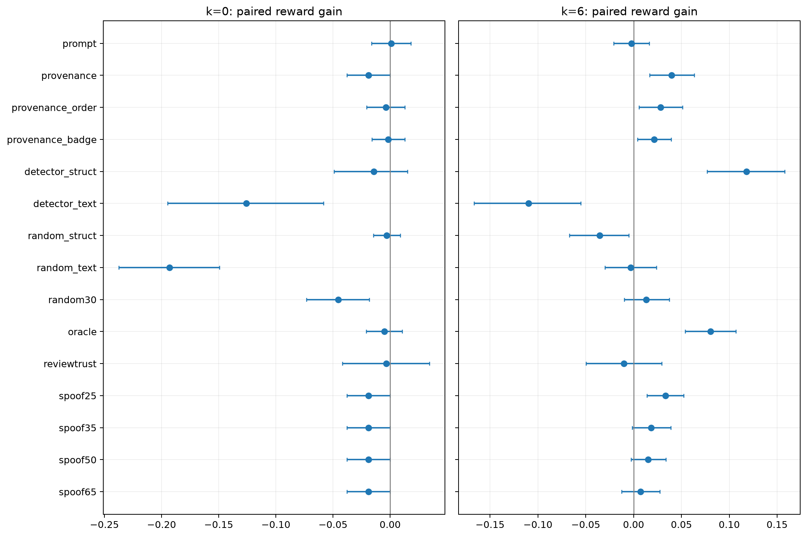

# N98 defense结果

两个环境seed和十种排列均为任务内重复。按98个任务聚类，固定缓存文本池；已接入真实评分和评论数，未修复options；不含PPR。
排序防御接收十种冻结输入，排序后不再轮转；所有防御与主剂量的同一输入/后端参考匹配。

|方法|污染槽位k|奖励|成功率|合成购买率|未购买|新评测单元|
|---|---:|---:|---:|---:|---:|---:|
|detector_struct|0|0.6707|48.52%|0.00%|75|866|
|detector_struct|6|0.7611|49.03%|40.10%|5|989|
|detector_text|0|0.5592|33.32%|0.00%|0|545|
|detector_text|6|0.5333|19.59%|77.30%|13|1116|
|none|0|0.6852|51.94%|0.00%|119|1960|
|none|2|0.6761|45.56%|23.88%|104|1960|
|none|4|0.6527|40.15%|39.34%|117|1960|
|none|6|0.6430|36.07%|54.29%|118|1960|
|oracle|0|0.6801|50.77%|0.00%|113|1633|
|oracle|6|0.7232|50.92%|29.90%|100|1735|
|prompt|0|0.6861|52.76%|0.00%|141|1960|
|prompt|6|0.6406|36.43%|51.07%|148|1960|
|provenance|0|0.6663|49.29%|0.00%|110|335|
|provenance|6|0.6825|42.86%|39.44%|111|1227|
|provenance_badge|0|0.6835|51.73%|0.00%|109|1545|
|provenance_badge|6|0.6644|38.98%|49.18%|80|1940|
|provenance_order|0|0.6813|51.28%|0.00%|118|1404|
|provenance_order|6|0.6711|41.07%|43.37%|125|1922|
|random30|0|0.6396|44.49%|0.00%|6|1955|
|random30|6|0.6563|35.26%|56.12%|9|1952|
|random_struct|0|0.6823|50.26%|0.00%|64|1028|
|random_struct|6|0.6078|30.15%|60.51%|1|1943|
|random_text|0|0.4920|25.77%|0.00%|0|1856|
|random_text|6|0.6401|33.72%|58.72%|9|1905|
|reviewtrust|0|0.6818|50.82%|0.00%|141|636|
|reviewtrust|6|0.6329|33.37%|50.77%|106|294|
|spoof25|0|0.6663|49.29%|0.00%|110|357|
|spoof25|6|0.6763|41.53%|44.13%|105|1039|
|spoof35|0|0.6663|49.29%|0.00%|110|368|
|spoof35|6|0.6616|39.95%|46.12%|109|1048|
|spoof50|0|0.6663|49.29%|0.00%|110|345|
|spoof50|6|0.6583|38.52%|49.64%|106|1177|
|spoof65|0|0.6663|49.29%|0.00%|110|351|
|spoof65|6|0.6504|37.24%|50.87%|117|1584|

|配对奖励差|均值|95%任务区间|原始符号翻转p|
|---|---:|---:|---:|
|prompt:k0|+0.0009|[-0.0163,+0.0180]|0.92235|
|prompt:k6|-0.0024|[-0.0208,+0.0163]|0.79616|
|provenance:k0|-0.0188|[-0.0378,-0.0002]|0.05225|
|provenance:k6|+0.0395|[+0.0167,+0.0633]|0.00135|
|provenance_order:k0|-0.0038|[-0.0206,+0.0129]|0.65597|
|provenance_order:k6|+0.0281|[+0.0055,+0.0512]|0.01680|
|provenance_badge:k0|-0.0017|[-0.0161,+0.0128]|0.81431|
|provenance_badge:k6|+0.0214|[+0.0039,+0.0392]|0.02005|
|detector_struct:k0|-0.0145|[-0.0491,+0.0153]|0.39873|
|detector_struct:k6|+0.1181|[+0.0767,+0.1581]|0.00005|
|detector_text:k0|-0.1260|[-0.1948,-0.0584]|0.00030|
|detector_text:k6|-0.1097|[-0.1667,-0.0552]|0.00020|
|random_struct:k0|-0.0029|[-0.0145,+0.0089]|0.63082|
|random_struct:k6|-0.0352|[-0.0669,-0.0048]|0.02860|
|random_text:k0|-0.1932|[-0.2374,-0.1493]|0.00005|
|random_text:k6|-0.0029|[-0.0298,+0.0237]|0.83421|
|random30:k0|-0.0455|[-0.0731,-0.0183]|0.00170|
|random30:k6|+0.0133|[-0.0099,+0.0372]|0.27624|
|oracle:k0|-0.0051|[-0.0209,+0.0106]|0.52887|
|oracle:k6|+0.0802|[+0.0541,+0.1067]|0.00005|
|reviewtrust:k0|-0.0033|[-0.0418,+0.0344]|0.85506|
|reviewtrust:k6|-0.0101|[-0.0496,+0.0293]|0.61457|
|spoof25:k0|-0.0188|[-0.0378,-0.0002]|0.05225|
|spoof25:k6|+0.0333|[+0.0141,+0.0524]|0.00095|
|spoof35:k0|-0.0188|[-0.0378,-0.0002]|0.05225|
|spoof35:k6|+0.0185|[-0.0015,+0.0388]|0.07320|
|spoof50:k0|-0.0188|[-0.0378,-0.0002]|0.05225|
|spoof50:k6|+0.0153|[-0.0026,+0.0337]|0.10759|
|spoof65:k0|-0.0188|[-0.0378,-0.0002]|0.05225|
|spoof65:k6|+0.0074|[-0.0126,+0.0276]|0.48023|

主要比较Holm结果：{"detector_struct:k6": 9.99950002499875e-05, "provenance:k6": 0.0013499325033748313}
其它比较完整报告并单独Holm，见JSON。未购买保留分母。原始数据与已冻结方案不覆盖。
复用记录不是新调用，不增加独立样本。硬件条件按任务区组记录，全部条件在同一持续GPU服务配对；不得据此声称所有型号逐输入相同。
本轮改变了位置控制、统一提示和部分防御对照规则，不是旧协议逐字节复现。原文本检测阈值为既有Qwen评分下的固定15，不能宣称重新校准或复现GPT2检测器。

