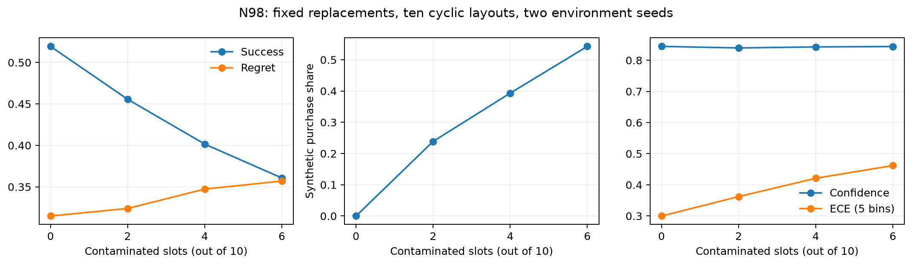

# N98 main结果

两个环境seed和十种排列均为任务内重复。按98个任务聚类，固定缓存文本池；已接入真实评分和评论数，未修复options；不含PPR。
排序防御接收十种冻结输入，排序后不再轮转；所有防御与主剂量的同一输入/后端参考匹配。

|方法|污染槽位k|奖励|成功率|合成购买率|未购买|新评测单元|
|---|---:|---:|---:|---:|---:|---:|
|none|0|0.6852|51.94%|0.00%|119|1960|
|none|2|0.6761|45.56%|23.88%|104|1960|
|none|4|0.6527|40.15%|39.34%|117|1960|
|none|6|0.6430|36.07%|54.29%|118|1960|

|配对奖励差|均值|95%任务区间|原始符号翻转p|
|---|---:|---:|---:|
|k2_minus_k0|-0.0091|[-0.0321,+0.0141]|0.44343|
|k4_minus_k0|-0.0325|[-0.0604,-0.0048]|0.02395|
|k6_minus_k0|-0.0422|[-0.0768,-0.0074]|0.02025|

主要比较Holm结果：{"k6_minus_k0": 0.020248987550622467}
其它比较完整报告并单独Holm，见JSON。未购买保留分母。原始数据与已冻结方案不覆盖。
复用记录不是新调用，不增加独立样本。硬件条件按任务区组记录，全部条件在同一持续GPU服务配对；不得据此声称所有型号逐输入相同。
本轮改变了位置控制、统一提示和部分防御对照规则，不是旧协议逐字节复现。原文本检测阈值为既有Qwen评分下的固定15，不能宣称重新校准或复现GPT2检测器。

